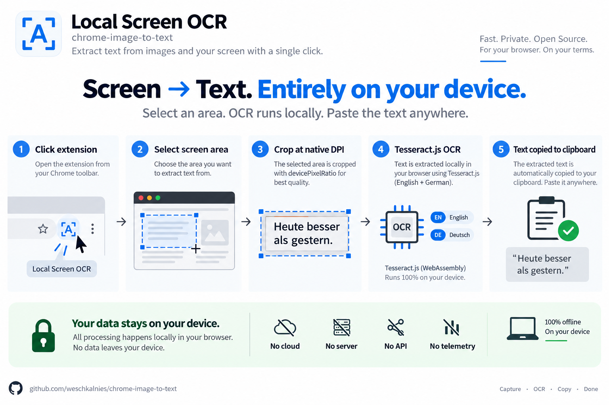

# LocalOCR: Screen to Text

A local Chrome extension (Manifest V3): select an area on screen, recognize it
offline with Tesseract.js, review or edit the text, then copy it. Image data
and OCR results never leave your device.



## Features

- 100% local OCR with Tesseract.js and 14 bundled language models
- Choose one or two OCR languages in the options; default is your browser
  language plus English
- Mouse-based selection, cancellable with `Esc`
- Editable result dialog with confidence, language and explicit copy action
- High-DPI and screenshot scaling based on the actual image dimensions
- No persistent host permissions: only `activeTab`, `scripting`, `offscreen`,
  and `storage` (language setting only)
- Robust worker, offscreen OCR, and injection management for Manifest V3

## Quick start

Requirements: a current version of Google Chrome or Chromium and Node.js.

```bash
npm run build
```

Then in Chrome:

1. Open `chrome://extensions/`.
2. Enable Developer mode.
3. Select **Load unpacked**.
4. Select the `deploy/` directory.

## Usage

1. Click the extension icon.
2. Drag across the area you want to recognize.
3. Review or edit the recognized text in the dialog.
4. Select **Copy** to write it to the clipboard.

`Esc` cancels an active selection or OCR operation, or closes the result dialog.

### OCR languages

Right-click the extension icon and choose **Options** (or select **Change
languages** in the result dialog) to pick one or two languages. With one
language OCR is fastest; with two, both are recognized in parallel and the
result with the higher confidence wins.

Without a saved choice the extension uses the browser language plus English
(English only if the browser language is English or not supported).

Supported: English, German, French, Spanish, Italian, Portuguese, Dutch,
Polish, Czech, Swedish, Danish, Turkish, Russian, Ukrainian.

To add a language, place `<code>.traineddata.gz` from
[`@tesseract.js-data/<code>/4.0.0_best_int`](https://www.jsdelivr.com/package/npm/@tesseract.js-data/eng)
in `src/lib/` and add an entry to `src/lib/ocr/languages.js`.

## Development

`src/` is the single source of truth. `deploy/` and `tests/deploy-autotest/`
are generated and must not be edited manually.

```bash
npm run build              # generate deploy/ from src/
npm run build:autotest     # also generate the test extension
npm run check              # verify that deploy/ is current
```

Install the test dependencies once before running the browser tests:

```bash
npm --prefix tests ci
npm run test:background-injection
npm run test:worker-lifecycle
npm run test:e2e
```

`test:e2e` covers the complete flow, including OCR, the result dialog and the
explicit copy action.

## Project structure

```text
chrome-image-to-text/
├── src/                    # extension source code
│   ├── background.js        # service worker: screenshot, injection, offscreen routing
│   ├── content.js           # selection, crop and UI orchestration
│   ├── content.css          # selection overlay styles
│   ├── offscreen.html       # isolated MV3 offscreen document for local OCR
│   ├── offscreen.js         # offscreen OCR controller
│   ├── options.html/.js/.css # language settings page
│   ├── icons/               # icon family
│   └── lib/                 # OCR, UI and local Tesseract resources
├── deploy/                  # generated extension loaded in Chrome
├── tests/                   # browser and regression tests
├── tools/build.js           # build and drift check
└── package.json             # npm scripts
```

## Privacy and security

- No cloud, telemetry or external OCR requests.
- OCR runs inside an isolated MV3 offscreen document (`offscreen.html`) without
  `web_accessible_resources` (`<all_urls>`), keeping local Tesseract assets
  inaccessible to visited websites.
- The editable result dialog uses a closed Shadow DOM, so scripts on the
  visited website cannot read the recognized text.
- **Chrome Web Store Enhanced Safe Browsing notice:** If you have Chrome's
  *Enhanced Safe Browsing* enabled, you may see *"This extension is not trusted
  by Enhanced Safe Browsing"* when installing from the Chrome Web Store. This is
  Google's standard automated notice for newer Chrome Web Store developer
  accounts—not a security finding—and disappears automatically after a few
  months of policy-compliant account history. The full source code is open in
  this repository for inspection or local building (`npm run build`).

## Release checklist

Before a release:

```bash
npm run build
npm run check
npm run test:e2e
```

The project can then be tested as an unpacked extension from `deploy/` or
packaged for the relevant distribution channel.

## Support

If you would like to support the project, you can buy me a coffee:
[Buy Me a Coffee](https://buymeacoffee.com/weschkalnies).

## License

No license has been selected for this repository yet. Tesseract.js and the
bundled Tesseract resources are subject to their respective licenses.
